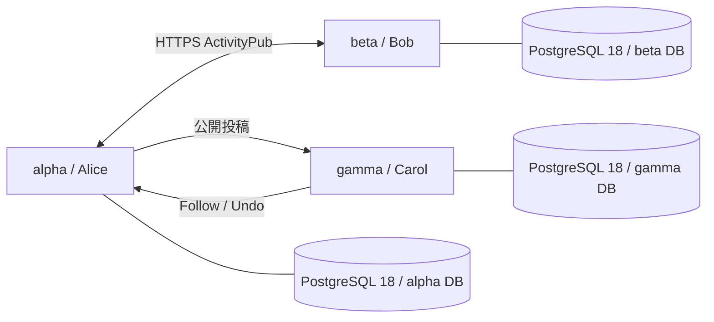

# コンテナ間の連合回帰テスト

同じメンテナンス版の Misskey を 3 台、独立したコンテナで起動する。
各サーバーは個別の PostgreSQL 18 データベース、Redis prefix、設定、RSA 鍵、
ファイル保存領域を持つ。既存 DB や利用者のデータは使用しない。



Docker の内部ネットワーク上に Misskey 3 コンテナ、PostgreSQL 18 と Redis を起動する。
ホストにはポートを公開しない。実行ごとに専用 CA と各ホストの証明書を生成し、
`NODE_EXTRA_CA_CERTS` で公開証明書を信頼する。TLS 検証を無効にはしない。
証明書の秘密鍵は一時領域にのみ置き、成果物やイメージに含めない。
添付取得が通常のプライベート IP 拒否に止められないよう、既存の
`allowedPrivateNetworks` 設定に、この実行専用の Docker サブネットだけを渡す。
一般の外部ネットワークを許可せず、SSRF 拒否処理そのものも変更しない。

## 実行方法

Docker、OpenSSL、リポジトリ指定版の Node / Yarn、インストール済みの依存が必要。
初回はフロントエンドも含め `yarn build` を実行する。

```sh
yarn test:federation
```

テストはソースマップ付きのバックエンドをビルドしてから、専用 Docker イメージを作る。
依存はコンテナ内で frozen lockfile を使ってインストールする。
試験スクリプトは checkout の `scripts/` を読み取り専用でマウントする。
ビルド時に社内プロキシ等の CA が必要なら、公開 CA ファイルを
`FEDERATION_BUILD_CA=/path/to/ca.pem` で渡す。BuildKit secret として使い、
コンテナイメージや連合用 CA には保存しない。

スクリプトだけを調整して再実行する場合は `yarn test:federation --reuse-image` で
前回のイメージを利用できる。コンテナ内の Node 版、バックエンド JS・ソースマップ、
依存の package.json・lockfile が現在の checkout と一致しなければ失敗する。
CI では省略せず毎回ビルドする。

同一 checkout の実行は直列にする。終了時は成功・失敗にかかわらず、この実行の
名前と所有ラベルが一致するコンテナだけを停止・削除し、専用ネットワークと設定を片付ける。
PostgreSQL のデータは tmpfs に置き、既存の PG データディレクトリを更新しない。
強制終了やホスト障害で残ったリソースは `io.misskey.federation` ラベルで識別できる。

## 検証する挙動

HTTPS の転送役の先で、通常の `built/boot/index.js`、実際の HTTP 署名、
Bull の送信・受信プロセッサ、実 DB を使う。テストドライバーは HTTP と DB と
キュー状態を観測し、結果が反映されるまで期限を設けて待つ。

| シナリオ | 確認する結果 |
| --- | --- |
| Actor discovery | 実 HTTPS で未知 Actor を解決し、相手のホストと別々の公開鍵を確認 |
| Follow / Accept | 双方向のフォローと第 3 サーバーからのフォローが成立し、実配送を確認 |
| Create / Reply | 日本語・絵文字を含む投稿が 2 台に保存され、逆方向の返信が元投稿を参照 |
| Like / Undo / Announce | 元サーバーのリアクション行の追加・削除、Renote の参照関係 |
| specified | 指定相手が本文を読め、匿名には本文が隠れる。フォロー中の第 3 サーバーに配送・保存されない |
| Undo Follow / followers / 再フォロー | 解除後のフォロワー限定投稿は配送・保存されず、再フォローすると配送が再開 |
| home | 公開範囲と本文が受信後も一致 |
| 投票 | リモートの投票が元サーバーの票数を更新 |
| 添付 | リモート画像の HTTPS 取得、MIME・MD5・元バイト列の一致 |
| Update / Delete | プロフィールの反映と、両受信サーバーからの投稿削除 |
| 配送障害 | 相手の Inbox が一度 503 を返すと実 Bull ジョブが再試行を予約し、その後 202 で成功。保存行は 1 件 |
| 通信の整合性 | 各 Inbox リクエストの本文 digest と公開鍵による RSA HTTP 署名検証 |
| 実行時エラー | 全 3 サーバーに未処理 rejection / 例外が発生していない |

503 の注入はこのイメージの HTTPS 転送役にのみある制御用ルートで行う。
再試行ジョブが delayed に入ったことと試行回数を確認し、Bull の `promote()` で
すぐ実行する。アプリの再試行設定は変更しないが、実時間のバックオフ間隔の正しさは
この試験の対象にしない。

## 証拠とカバレッジ

`.maintenance-federation/latest/` に以下を保存する。

- `scenarios.json` / `summary.md`: ケース別の成否と失敗原因。
- `alpha-wire.jsonl` 等: 実際の Inbox 通信、Activity、署名、digest、HTTP ステータス。
- `alpha-container.log` 等: 起動、migration、送受信キューのログ。
- `*-errors.jsonl`: 発生した場合の未処理例外。
- `postgres-version.txt`: 実 DB バージョン。
- `v8/` / `coverage/`: 3 サーバーの実行カバレッジを TypeScript に対応づけた結果。
- `build.json`: バックエンド JS とソースマップのハッシュ、PG のメジャーバージョン。

同じビルドで先に `yarn test:regression` を通していれば、そのカバレッジと統合し
`combined-coverage.json` を作る。ビルドのハッシュが違う結果は混ぜない。
CI は回帰テスト → 連合試験 → 統合カバレッジによる変更行・分岐チェックの順で実行し、
失敗時も作成済みの証拠を artifact に保存する。

```sh
REGRESSION_BASE_REF=<修正前の40桁SHA> \
REGRESSION_PATCH_COVERAGE=.maintenance-federation/latest/combined-coverage.json \
yarn test:regression:patch
```

これは同じ版の Misskey 同士の試験であり、Mastodon 等の他実装との互換性や、
すべての Activity・鍵更新・リレー・競合・再起動・負荷への耐性の保証ではない。
各脆弱性の修正時には攻撃入力と正常入力の専用ケースを加える。
巨大な既存 DB の移行時間やロックは、少量の空 DB テストからは判断できない。

## 試験で見つかった互換性不具合

メンテナンス版で追加した Inbox の入力検証が、Misskey 自身の期限なし投票の
`endTime: null` を拒否していた。実際に 2 台の Inbox が HTTP 400 を返し、
受信側 DB に投票付き投稿が存在しないことで検出した。
型定義と JSON 検証を `null` に対応させる修正を、試験基盤とは別コミットに分けた。
単体テストでは `null`・期限文字列・省略の受理と、数値・オブジェクト・配列の拒否、
入力を書き換えないことを確認する。コンテナ試験では期限なし投票をそのまま使用し、
投稿の配送と逆方向の投票が元サーバーに反映されることを確認する。

初期構成では、許可外のプライベート IP からの添付取得を拒否した際に
`Premature close` の未処理 rejection も観測した。拒否・ダウンロード失敗時の
エラー伝播は別途修正と専用の拒否テストが必要であり、この正常系の成功で
修正済みとは扱わない。

## 実測（2026-10-23、日本時間）

PostgreSQL 18 上の 3 台で全 17 シナリオが成功。37 件の Inbox 通信の digest と
HTTP 署名を 3 つの Actor 公開鍵で検証し、正常系の未処理例外は 0 件だった。
既存の 1,604 項目の回帰比較も差分 0、単体テストは投票期限の 6 ケースを加え
14 スイート・88 件が成功した。型検査と統合カバレッジによる変更行チェックも実施する。
